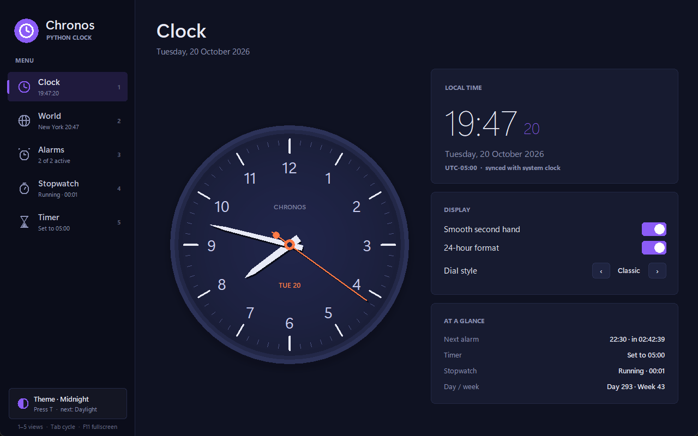
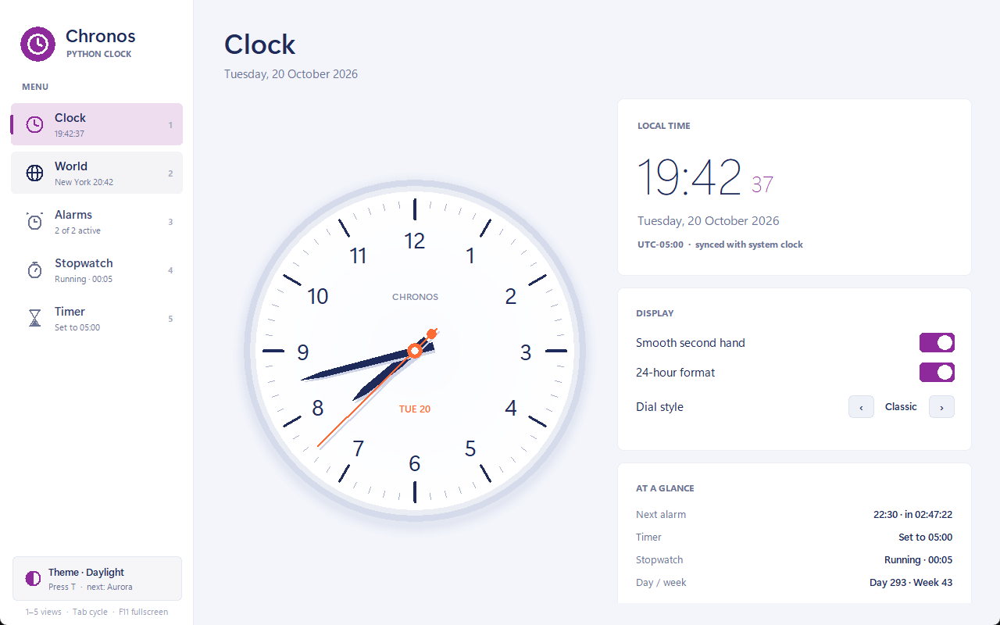
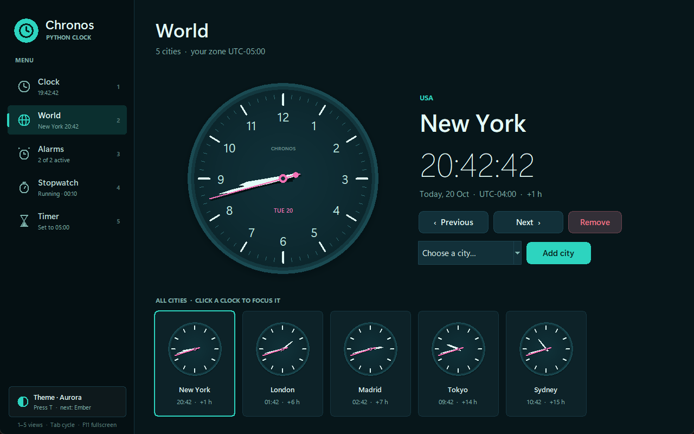
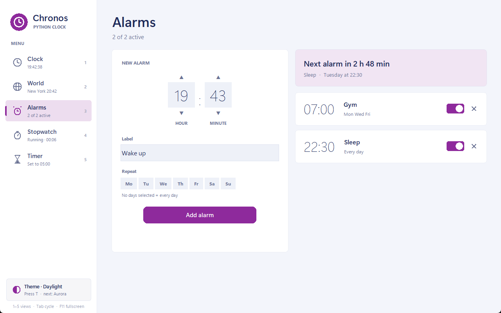
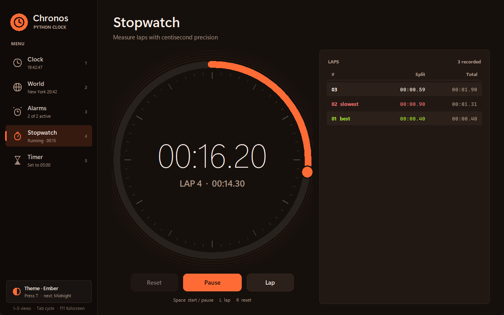

# Chronos · Python Clock

A desktop analog clock written **only in Python** (standard library + Tkinter, no HTML or CSS).
Three animated hands show the exact system time, and the app adds a world clock, alarms,
a stopwatch and a countdown timer, all with four colour themes.



## Run it

```bash
python main.py
```

Requires Python 3.10+ with Tkinter (included in the official Windows/macOS installers).
There are no third-party dependencies.

Run the tests:

```bash
python -m unittest discover -s tests -v
```

## Features

| Screen | What it does |
| --- | --- |
| **Clock** | Analog clock with hour, minute and second hands synced to the system clock. Smooth sweep or ticking second hand, 12/24-hour digital read-out, four dial styles (Classic, Roman, Quarters, Minimal), next-alarm and status summary. |
| **World** | Featured analog clock for the selected city plus a strip of mini clocks. Previous/next navigation, add cities from a catalog of 22, remove cities, time difference from your zone. |
| **Alarms** | Create alarms with hour, minute, label and repeat days. Toggle or delete them, see the time left to the next one. A pop-up with sound appears when an alarm rings, with *Snooze 5 min* or *Dismiss*. |
| **Stopwatch** | Centisecond stopwatch with laps; the fastest and slowest laps are highlighted. |
| **Timer** | Countdown with a progress ring, preset carousel (1 min to 1 h), custom duration and +1 min. Rings when it reaches zero. |

Themes: **Midnight**, **Daylight**, **Aurora** and **Ember**.

### Keyboard shortcuts

| Key | Action |
| --- | --- |
| `1` – `5` | Go to Clock, World, Alarms, Stopwatch, Timer |
| `Tab` / `Shift+Tab` | Next / previous screen |
| `T` | Next theme |
| `D` | Next dial style (Clock screen) |
| `Space` | Start / pause (Stopwatch, Timer) |
| `L` / `R` | Lap / reset (Stopwatch); `R` reset (Timer) |
| `←` `→` | Previous / next city (World) or preset (Timer) |
| `F11` / `Esc` | Toggle / leave full screen |

## Data structures

The backend is built around a **circular doubly linked list**
([`clock_app/structures/circular_doubly_linked_list.py`](clock_app/structures/circular_doubly_linked_list.py)):
each `Node` points to `next` and `prev`, the tail links back to the head, and the head links back
to the tail. A `RingCursor` walks the ring in both directions and can `seek` a value by exploring
forwards and backwards at the same time.

Where it is used:

| Use | Why a circular doubly linked list fits |
| --- | --- |
| **Clock hands** (`DialRing` of 60 or 12 marks) | Each hand is a cursor over its ring. Going from 59 to 0 is just following `next`, without modulo arithmetic. A jump (new city) uses the two-way `seek`. |
| **Dial ticks** | The face is drawn by iterating the 60 nodes of the minute ring. |
| **World clock cities** | *Next* and *previous* wrap from the last city to the first and back. Cities stay sorted by UTC offset with `insert_sorted`. |
| **Alarms** | Kept sorted by time of day; adding is an ordered insertion. |
| **Alarm notification queue** | `LinkedQueue` (FIFO) on top of the list: O(1) enqueue at the tail, O(1) dequeue at the head. |
| **Stopwatch laps** | O(1) append; the view walks the list backwards to show the newest lap first. |
| **Timer presets, themes, dial styles, screens** | Carousels that wrap around with a cursor. |

## Object-oriented design

```
clock_app/
├── structures/   Node, CircularDoublyLinkedList, RingCursor, LinkedQueue
├── core/         TimeProvider ─┬─ SystemTimeProvider
│                               └─ FixedOffsetTimeProvider
│                 Hand ─┬─ HourHand
│                       ├─ MinuteHand
│                       └─ SecondHand
│                 DialRing, ClockEngine
├── features/     Feature ─┬─ Stopwatch
│                          ├─ CountdownTimer
│                          ├─ AlarmManager
│                          └─ WorldClock
└── ui/           View ─┬─ ClockView, WorldView, AlarmView, StopwatchView, TimerView
                  DialStyle ─┬─ ArabicDial, RomanDial, QuarterDial, MinimalDial
                  Icon ─┬─ ClockIcon, GlobeIcon, AlarmIcon, StopwatchIcon, HourglassIcon, ThemeIcon
                  Widgets: RoundedButton, ToggleSwitch, Card, ProgressRing, Stepper, Chip...
```

- **Abstraction**: `TimeProvider`, `Hand`, `Feature`, `View`, `DialStyle` and `Icon` are abstract
  base classes (`abc.ABC`) that declare what every subclass must implement.
- **Inheritance**: concrete hands, features, views, dial styles and icons extend those bases.
- **Polymorphism**:
  - `ClockEngine` updates `for hand in self.hands: hand.update(moment)` without knowing which hand it is.
    Each hand overrides `read()`, and `SecondHand` overrides `polygon()` to draw a thin line instead of a blade.
  - The same engine runs on local time or on any city, because both providers implement `now()`.
  - The main loop calls `feature.tick(now)` on every feature and `view.refresh(now)` on whichever screen is visible.
  - The analog clock asks the current `DialStyle` for the label of each hour (`"3"`, `"III"` or nothing).
- **Encapsulation**: the backend keeps its state private and only exposes methods like `start()`, `lap()`, `snooze()`.
- **Observer pattern**: features `emit()` events (`finished`, `ringing`, `changed`) that the views subscribe to,
  so the backend never imports the UI.

The interface is rebuilt from scratch when the theme changes. All state lives in the backend objects
owned by `ClockApp`, so nothing is lost.

## Notes

- Time zones use fixed UTC offsets to stay dependency-free (Windows does not ship the IANA database).
  Daylight saving time changes are not applied automatically.
- Alarm sound uses `winsound` on Windows and the Tk bell elsewhere.

## Screenshots

| Daylight theme | World (Aurora) |
| --- | --- |
|  |  |
| **Alarms** | **Stopwatch (Ember)** |
|  |  |
